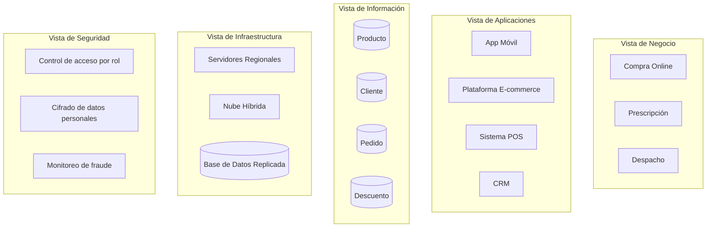
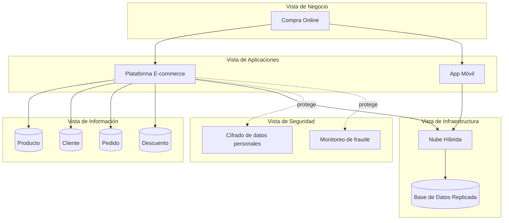
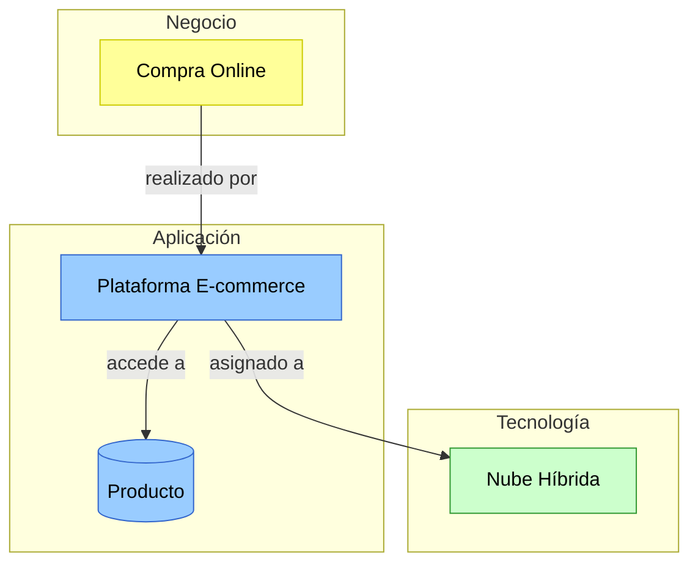

# Guía Paso a Paso: Integración de Vistas de Arquitectura

Esta guía complementa el `README.md` del taller. A diferencia de los talleres anteriores, aquí no se construye una vista nueva: se **integran** las que ya se hicieron —el AS-IS de los Talleres 1 a 6 (negocio, información, aplicaciones, infraestructura y seguridad) y, para el cliente real, el TO-BE del Taller 7 (Opportunities & Solutions)— en un solo tablero coherente, primero sobre el caso base de FarmApp (Parte 1) y luego sobre el cliente real (Parte 2).

El diagrama de ejemplo de esta guía está escrito en [Mermaid](https://mermaid.js.org/) y se renderiza automáticamente al ver este archivo en GitHub.

---

## 1. Metodología en 5 pasos

1. **Organizar las vistas en capas** — defina las 5 capas del tablero (negocio, aplicaciones, información, infraestructura, seguridad), una debajo de otra.
2. **Ubicar los elementos de cada vista dentro de su capa** — transcriba lo ya definido en los talleres anteriores, sin conectar todavía.
3. **Trazar relaciones verticales entre capas** — para un proceso de negocio a la vez, conecte cada elemento con la aplicación que lo soporta, la aplicación con su infraestructura, y ambas con la información y el control de seguridad que usan.
4. **Redactar la narrativa de coherencia** — explique en texto **por qué** esas conexiones tienen sentido y qué decisiones de talleres anteriores las originaron.
5. **Revisar consistencia** — verifique que ningún elemento quede "huérfano" (sin conexión hacia arriba ni hacia abajo) y que la narrativa cubra las 5 capas.

Con el cliente real, en el Paso 2 agregue además los elementos TO-BE del Taller 7 a la capa que les corresponde y márquelos con la etiqueta **NUEVO** (la misma convención de la visualización del Taller 7). En el Paso 3 trace también sus conexiones nuevas, marcadas de la misma forma, para que en el tablero se distinga qué es AS-IS y qué es TO-BE.

---

## 2. Ejemplo guiado: Tablero integrado de FarmApp

FarmApp es un caso de clase: cuando el ejemplo dice que algo se decidió en el Taller 4 o en el Taller 5, indica de qué taller saldría ese hallazgo en un cliente real.

### Paso 1 — Organizar las vistas en capas

| Capa | Contenido esperado |
|---|---|
| Negocio | Procesos: Compra Online, Prescripción, Despacho |
| Aplicaciones | App Móvil, Plataforma E-commerce, Sistema POS, CRM |
| Información | Entidades: Producto, Cliente, Pedido, Descuento |
| Infraestructura | Servidores Regionales, Nube Híbrida, Base de Datos Replicada |
| Seguridad | Control de acceso por rol, Cifrado de datos personales, Monitoreo de fraude |

### Paso 2 — Ubicar los elementos de cada vista

Se transcribe el inventario completo de cada capa, sin conectar nada todavía. Este es el punto de partida — normalmente ya existe en los entregables de los Talleres 1 a 6 (AS-IS) y, para el cliente real, en el TO-BE del Taller 7.



### Paso 3 — Trazar relaciones verticales entre capas

Conectar las 5 capas completas de una vez satura el tablero. Se traza primero **un hilo de negocio completo**, de punta a punta: el proceso **Compra Online**. El mismo método se repite después para Prescripción y Despacho.



### Paso 4 — Redactar la narrativa de coherencia

La narrativa no describe el diagrama — explica las decisiones detrás de él. Ejemplo para el hilo de Compra Online:

> "El proceso de Compra Online se apoya en la Plataforma E-commerce y en la App Móvil, priorizadas porque la mayoría de las compras de FarmApp ya ocurren desde dispositivos móviles. Ambas comparten las mismas entidades de información (Producto, Cliente, Pedido, Descuento) para evitar inconsistencias de inventario entre canales. Corren sobre la Nube Híbrida con Base de Datos Replicada — decisión tomada en el Taller 4 para tolerar picos de demanda en campañas promocionales. El cifrado de datos personales y el monitoreo de fraude se aplican en este punto porque el proceso involucra pago electrónico, el activo más sensible identificado en el Taller 5."

### Paso 5 — Revisar consistencia

Se verifica que cada elemento del hilo tenga al menos una conexión hacia la capa de arriba y una hacia la de abajo (salvo la capa más alta y la más baja). Un elemento sin ninguna marca está huérfano: o sobra en el tablero, o falta trazar su relación.

| Elemento | Capa | ¿Conectado hacia arriba? | ¿Conectado hacia abajo? |
|---|---|---|---|
| Compra Online | Negocio | — (capa más alta) | E-commerce, App Móvil |
| Plataforma E-commerce | Aplicaciones | Compra Online | Info, Nube Híbrida, Seguridad |
| App Móvil | Aplicaciones | Compra Online | Nube Híbrida |
| Producto / Cliente / Pedido / Descuento | Información | E-commerce | — (en este hilo no se trazó su relación con Infraestructura) |
| Nube Híbrida | Infraestructura | E-commerce, App Móvil | Base de Datos Replicada |
| Base de Datos Replicada | Infraestructura | Nube Híbrida | — |
| Cifrado / Monitoreo de fraude | Seguridad | E-commerce | — (capa más baja) |

Para explorar este mismo tablero de forma interactiva —alternando entre capas sueltas e hilo trazado, con narrativa por conexión— vea [`visualizacion-integracion-vistas.html`](visualizacion-integracion-vistas.html).

---

## 3. Errores comunes a evitar

| Error frecuente | Por qué es un problema | Cómo corregirlo |
|---|---|---|
| Dibujar las 5 vistas por separado sin conectarlas | El tablero se convierte en 5 diagramas pegados, no en una arquitectura integrada | Trace explícitamente las relaciones verticales entre capas (Paso 3) |
| Conectar aplicaciones e infraestructura pero omitir la vista de seguridad | La seguridad queda como un anexo en vez de una decisión arquitectónica | Para cada hilo de negocio, identifique qué control de seguridad protege ese flujo |
| Narrativa que describe el diagrama en vez de justificar las decisiones | No aporta valor sobre lo que ya se ve en el tablero | Explique el "por qué" (ej. por qué esa infraestructura, por qué esas entidades), no el "qué" |
| Elementos de talleres anteriores que no aparecen en el tablero integrado | Da la impresión de que el trabajo previo se descartó | Revise que cada entregable de los Talleres 1–6 (AS-IS) y, con el cliente real, del TO-BE del Taller 7 tenga un lugar en el tablero final |

---

## 4. Checklist de autoevaluación antes de entregar

- [ ] Las 5 vistas (negocio, información, aplicaciones, infraestructura, seguridad) están representadas como capas del tablero.
- [ ] Se trazó al menos un hilo completo de negocio de punta a punta por las 5 capas.
- [ ] Ningún elemento relevante queda sin conexión hacia arriba o hacia abajo (ver tabla de verificación del Paso 5).
- [ ] La narrativa explica el "por qué" de las conexiones clave, no solo las describe.
- [ ] Los elementos del tablero son consistentes con los entregables de los talleres anteriores (mismos nombres, mismas decisiones).
- [ ] Los elementos y conexiones TO-BE del Taller 7 están en el tablero y marcados como NUEVO.

---

## Vista ArchiMate equivalente

Este taller **es**, en esencia, lo que ArchiMate hace de forma nativa (ver la [Guía de Notación ArchiMate](https://github.com/CesarAVegaF312/AREM-ArchiMate/blob/main/guia_notacion_archimate.md)): mostrar negocio, aplicación y tecnología en una sola vista conectada. El tablero de capas del Paso 2 y el hilo conectado del Paso 3 son, literalmente, un diagrama ArchiMate multi-capa — solo que hasta ahora se construyó con formas genéricas en vez de con la notación estándar.



Si su equipo construyó el tablero del Taller 8 con la notación ArchiMate en vez de formas libres, este diagrama ya es la vista final que necesita — no hay que redibujar nada dos veces.

---

## 5. Validación técnica de la consistencia (opcional)

La tabla del Paso 5 se llena a mano y funciona bien con un hilo. Con las 5 capas completas y los elementos TO-BE del Taller 7, revisar a ojo que nada quede huérfano o repetido se vuelve poco confiable. Esta sección propone hacer esa revisión con herramientas. No es un ejercicio de programación: el modelo del caso base y el verificador ya están listos en [`validacion-tecnica/`](validacion-tecnica/).

### 5.1 Qué se necesita

- [Archi](https://www.archimatetool.com/) (gratuito), para abrir el modelo y usar su validador.
- [Docker Desktop](https://www.docker.com/products/docker-desktop/) (o Docker Engine en Linux), para el verificador automático. No necesita conexión a internet después de descargar la imagen.

### 5.2 El modelo del caso base

[`farmapp-modelo-integrado.xml`](validacion-tecnica/farmapp-modelo-integrado.xml) es el tablero de FarmApp en el formato estándar de intercambio de ArchiMate (Model Exchange File Format de The Open Group), validado contra su esquema oficial. Trae el inventario completo del Paso 2 y el hilo Compra Online del Paso 3 en una vista llamada "Hilo Compra Online". Cada capa del tablero corresponde a tipos de ArchiMate:

| Capa del tablero | Tipo de ArchiMate en el modelo |
|---|---|
| Negocio | Business Process |
| Aplicaciones | Application Component |
| Información | Data Object |
| Infraestructura | Node, System Software |
| Seguridad | Requirement (igual que en la vista ArchiMate del Taller 5) |

**El modelo trae a propósito un error típico de integración.** El equipo que hizo el mapa de infraestructura (Taller 4) llamó al componente "Plataforma Ecommerce" y el que hizo el C4 (Taller 3) lo llamó "Plataforma E-commerce". Al juntar las vistas quedaron dos elementos distintos: uno conectado al negocio y a la información, y otro conectado a la Nube Híbrida. Cada vista, por separado, se ve correcta.

### 5.3 Revisión en Archi

1. En Archi: `File → Import → ArchiMate Model Exchange File...` y elija `farmapp-modelo-integrado.xml` (el mismo procedimiento del [ejemplo importable de AREM-ArchiMate](https://github.com/CesarAVegaF312/AREM-ArchiMate#ejemplo-importable-en-archi)).
2. Abra la vista "Hilo Compra Online": los dos componentes aparecen uno al lado del otro.
3. Ejecute el validador de Archi (Validator, en el menú `Tools`) y revise sus advertencias, por ejemplo elementos que no están en ninguna vista y posibles duplicados.

### 5.4 Verificador automático

Desde la carpeta `clase/validacion-tecnica/`:

```bash
docker compose run --rm verificar
```

[`verificar_consistencia.py`](validacion-tecnica/verificar_consistencia.py) hace automáticamente la tabla del Paso 5 y otras cuatro revisiones:

| Revisión | Qué encuentra en el caso base |
|---|---|
| 1. Estructura del archivo | Sin errores: todos los tipos existen en ArchiMate y toda relación apunta a un elemento que existe |
| 2. Elementos sin ninguna relación | Prescripción, Despacho, Sistema POS, CRM, Servidores Regionales y Control de acceso por rol: son los elementos de los otros hilos, que todavía no se trazan |
| 3. Conexión hacia arriba y hacia abajo (la tabla del Paso 5) | Las 4 entidades de información no tienen conexión hacia la infraestructura, la misma observación que hace la tabla del Paso 5. Además, "Plataforma Ecommerce" no tiene conexión hacia arriba |
| 4. Elementos fuera de las vistas | Los mismos 6 elementos de la revisión 2 |
| 5. Posibles duplicados | "Plataforma E-commerce" y "Plataforma Ecommerce": el error sembrado |

Para la revisión 3 se usa la misma regla de la guía: una conexión con un elemento de la misma capa cuenta si ese elemento sí está conectado (la Base de Datos Replicada llega a las aplicaciones a través de la Nube Híbrida). La conexión hacia abajo se exige a Negocio, Aplicaciones e Información.

Al corregir el error en Archi (borrar "Plataforma Ecommerce" y trazar la relación `asignado a` desde la Nube Híbrida hacia "Plataforma E-commerce"), exportar de nuevo en el mismo formato (`File → Export`, opción de Open Exchange File) y volver a correr el verificador, desaparece el duplicado y quedan solo los pendientes reales: los otros hilos y la relación entre información e infraestructura.

### 5.5 Aplicarlo al cliente real

1. Construya el tablero del cliente en Archi (o pase a Archi el de draw.io), incluyendo los elementos TO-BE del Taller 7.
2. Exporte el modelo en formato Open Exchange (`File → Export`) y guárdelo en `entrega/validacion-tecnica/modelo-cliente.xml`, junto con una copia de `docker-compose.yml` y `verificar_consistencia.py`.
3. Corra el verificador sobre su modelo: `docker compose run --rm verificar /trabajo/modelo-cliente.xml`.
4. En `entrega/informe.md`, explique cada hallazgo: qué corrigió, y qué queda pendiente a propósito y por qué. Un huérfano justificado ("este sistema se retira en el TO-BE") es una decisión; uno sin explicar es un error.

---

## 6. Análisis de caso real y panorama tecnológico (opcional)

### 6.1 Caso: la pérdida del Mars Climate Orbiter (NASA, 1999)

**Qué pasó.** El 23 de septiembre de 1999, la sonda Mars Climate Orbiter se perdió al intentar entrar en órbita de Marte. Según la Junta de Investigación del Accidente de la NASA (informe Phase I, 10 de noviembre de 1999), la causa raíz fue un archivo de software en tierra, llamado "Small Forces" (SM_FORCES), que entregaba los datos del impulso de los propulsores en unidades inglesas (libra-fuerza por segundo). La especificación de interfaz entre los sistemas exigía unidades métricas (newton por segundo), y el equipo de navegación, que calculaba la trayectoria con esos datos, asumió que venían en métrico, como decía la especificación. El error de trayectoria llevó a la sonda a una altura mucho menor que la planeada: las fuentes coinciden en unos 57 km, pero difieren en la altura objetivo. La Junta concluyó también que el proceso de verificación y validación del proyecto no revisó adecuadamente el software de tierra, y que ningún control del proyecto detectó el error.

**Qué falló, en el lenguaje de este taller.**

| Elemento | Qué falló |
|---|---|
| Relación entre dos vistas (el archivo que pasaba de un sistema al otro) | Cada sistema era correcto por separado; la inconsistencia estaba en la conexión entre los dos |
| Especificación de interfaz | Existía y decía qué unidades usar, pero nadie verificó que se cumpliera |
| Revisión de consistencia (Paso 5) | No se revisó la integración: cada equipo validó su propia parte |

**Relación con la validación técnica.** Es el error sembrado en el modelo de la sección 5 a escala real: dos equipos, cada uno con una vista correcta, que al integrarse no hablan de lo mismo. La revisión de duplicados encuentra nombres que solo difieren en mayúsculas, tildes, espacios o guiones; un error de unidades, en cambio, solo aparece si la integración se revisa expresamente.

**Preguntas para el análisis.**

1. Dibuje el caso como un tablero de dos capas (software de tierra y software de navegación). ¿Dónde estaba la relación que nadie revisó?
2. ¿Qué diría la narrativa del Paso 4 sobre esa relación, si alguien la hubiera escrito?
3. En el tablero del cliente real, ¿qué relaciones cruzan de un taller a otro (de un equipo a otro) y quién verifica que los dos extremos digan lo mismo?

**Fuentes.** [NASA, Mars Climate Orbiter Mishap Investigation Board, Phase I Report (10 de noviembre de 1999)](https://llis.nasa.gov/llis_lib/pdf/1009464main1_0641-mr.pdf); [informe Phase II de la misma Junta](https://discovery.larc.nasa.gov/PDF_FILES/mars_climate_orbiter_phaseII.pdf). Las cifras de costo publicadas difieren según incluyan solo el orbitador o todo el programa Mars Surveyor 98; por eso no se citan aquí.

### 6.2 Panorama tecnológico: herramientas para mantener integradas las vistas

| Herramienta | Tipo | Conviene cuando |
|---|---|---|
| [Archi](https://www.archimatetool.com/) | Gratuita y de código abierto, solo ArchiMate. Con el complemento coArchi, el modelo se comparte por Git | Un equipo pequeño o un curso necesita modelar en ArchiMate sin costo de licencia |
| Sparx Enterprise Architect | Comercial, de escritorio, varias notaciones (UML, BPMN, ArchiMate, SysML) en un mismo repositorio | La organización ya modela software y procesos y quiere todo en una sola herramienta |
| Bizzdesign Horizzon | Comercial, plataforma de arquitectura empresarial con análisis y tableros | Un área de arquitectura grande que necesita análisis de impacto y gobierno del modelo |
| SAP LeanIX | Comercial, en la nube, centrada en el inventario y ciclo de vida de aplicaciones | Lo prioritario es saber qué aplicaciones existen, quién las usa y cuándo se retiran, más que dibujar vistas |
| Ardoq | Comercial, en la nube, modelo en forma de grafo con colaboración | Muchas personas de distintas áreas mantienen el modelo |
| MEGA HOPEX | Comercial, arquitectura empresarial integrada con gestión de riesgos y cumplimiento | La arquitectura debe conectarse con riesgo y cumplimiento (sector financiero, salud) |
| ArchiMate Model Exchange File Format | Formato estándar de The Open Group, no una herramienta | Se necesita pasar un modelo de una herramienta a otra o revisarlo con scripts, como en la sección 5 |

Ninguna herramienta reemplaza la revisión del Paso 5: un repositorio central evita que existan dos copias del mismo elemento, pero no detecta que dos equipos entiendan distinto la misma relación. La elección depende del tamaño del área de arquitectura, de si el modelo lo mantiene una persona o muchas, y de con qué otros procesos (proyectos, riesgo, cumplimiento) debe conectarse.

### 6.3 Aplicarlo al cliente real

1. Busque un caso público y documentado de falla de integración entre sistemas o equipos en el sector del cliente.
2. Analícelo con la [plantilla de análisis de caso](../plantillas/plantilla_analisis_caso.md) y guárdelo en `entrega/analisis-caso.md`.
3. En la sección 5 de la plantilla, compare dos herramientas del panorama anterior para mantener el modelo del cliente después del curso.

---

_Esta guía hace parte del Taller 8 de Integración de Vistas de Arquitectura — curso Arquitectura Empresarial, Universidad de La Sabana._
